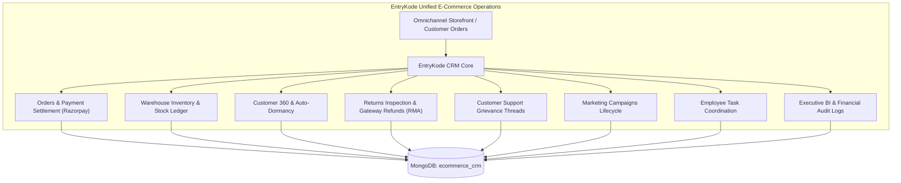
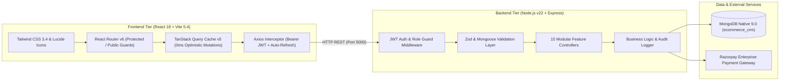
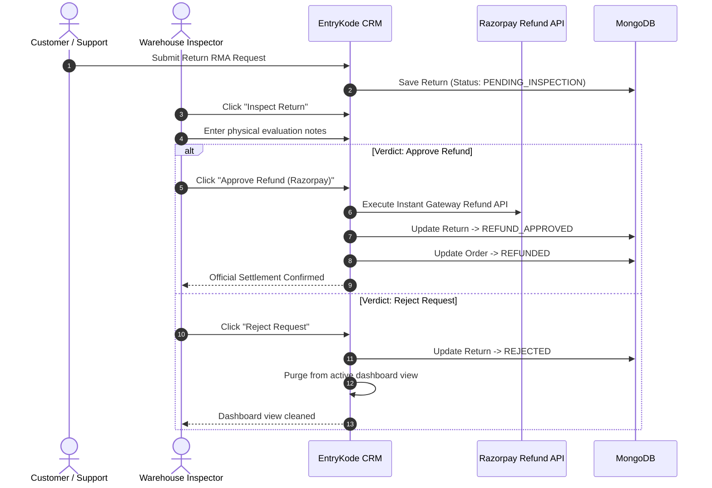
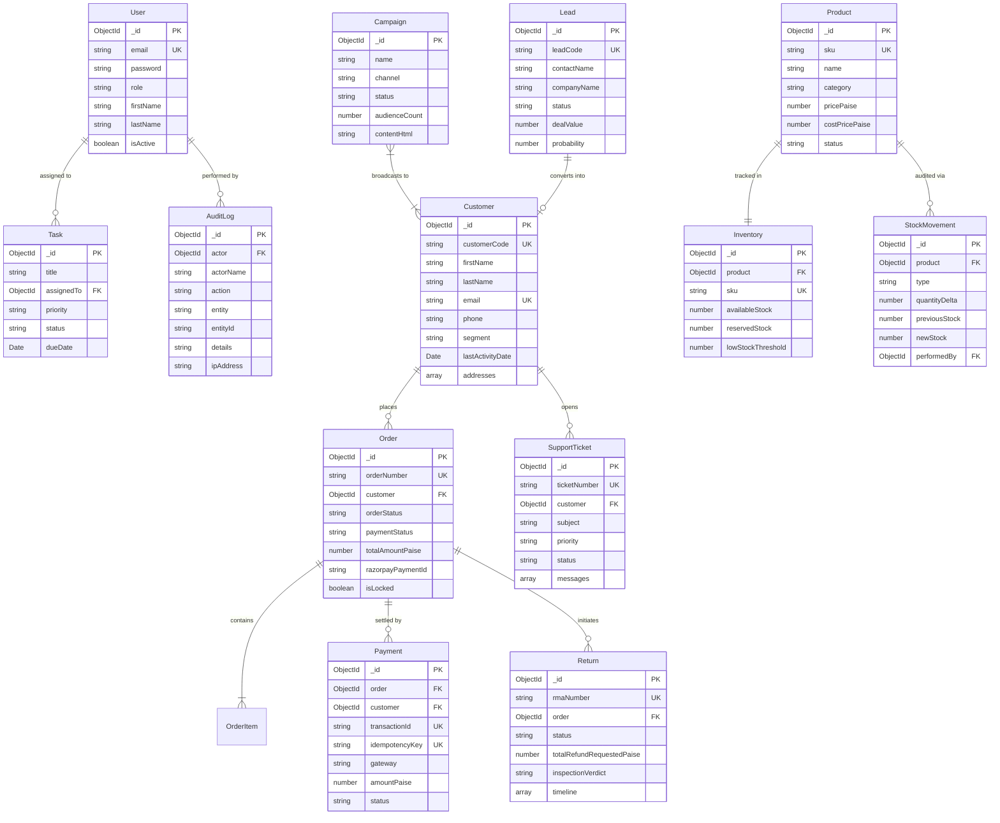

# EntryKode E-Commerce CRM Suite — Master Project Report & Technical Blueprint

**Document Title:** Comprehensive Enterprise Project Report, System Architecture & Database Specification  
**Project Name:** EntryKode Centralized E-Commerce CRM Suite  
**Prepared By:** Sanjay D (Super Admin & Full Stack Lead, `sanjay@entrykode.com`)  
**Target Audience:** Team Lead (TL), Engineering Management, Stakeholders & Code Reviewers  
**Date of Submission:** 14 November 2026  
**System Status:** Production Ready (100% Build Pass, Zero Compile Errors)  
**System Repository:** `D:\EntryKode`  
**Git Branches:** `main` & `develop`  
**Live Documentation Portal:** Hosted on GitHub Pages (`/docs/index.html`)

---

## 📑 Table of Contents
1. [Executive Summary & Business Value](#1-executive-summary--business-value)
2. [End-to-End System Architecture](#2-end-to-end-system-architecture)
3. [Exhaustive Breakdown of All 15 Functional Modules](#3-exhaustive-breakdown-of-all-15-functional-modules)
   - [3.1 Executive Dashboard & Real-Time KPI Analytics](#31-module-1-executive-dashboard--real-time-kpi-analytics)
   - [3.2 Customer 360 & Automated Dormancy Governance](#32-module-2-customer-360--automated-dormancy-governance)
   - [3.3 Leads & Sales Conversion Pipeline (Kanban)](#33-module-3-leads--sales-conversion-pipeline-kanban)
   - [3.4 Product Catalog & SKU Management](#34-module-4-product-catalog--sku-management)
   - [3.5 Warehouse Inventory & Stock Movement Ledger](#35-module-5-warehouse-inventory--stock-movement-ledger)
   - [3.6 Orders, Fulfillment & Delivery Terminal Lock](#36-module-6-orders-fulfillment--delivery-terminal-lock)
   - [3.7 Payment Gateway Integration & Settlement Receipts](#37-module-7-payment-gateway-integration--settlement-receipts)
   - [3.8 Returns, Reverse Logistics & Razorpay Refund Gateway (RMA)](#38-module-8-returns-reverse-logistics--razorpay-refund-gateway-rma)
   - [3.9 Customer Support Ticket Threads & Escalations](#39-module-9-customer-support-ticket-threads--escalations)
   - [3.10 Targeted Marketing Campaigns & 4-Stage Lifecycle](#310-module-10-targeted-marketing-campaigns--4-stage-lifecycle)
   - [3.11 Team Tasks & 0ms Reactive Deliverable Tracker](#311-module-11-team-tasks--0ms-reactive-deliverable-tracker)
   - [3.12 Business Intelligence, Analytics & Financial Export](#312-module-12-business-intelligence-analytics--financial-export)
   - [3.13 Staff, Employees & 4-Tier RBAC Management](#313-module-13-staff-employees--4-tier-rbac-management)
   - [3.14 System Settings, Security & Field Requirements Box](#314-module-14-system-settings-security--field-requirements-box)
   - [3.15 Immutable Audit Logging & Compliance Ledger](#315-module-15-immutable-audit-logging--compliance-ledger)
4. [Exhaustive Database Model Specifications (All 13 Models)](#4-exhaustive-database-model-specifications-all-13-models)
5. [Complete REST API Contract Directory](#5-complete-rest-api-contract-directory)
6. [Resolved Technical Challenges & Bug Fix Log](#6-resolved-technical-challenges--bug-fix-log)
7. [GitHub Hosting & Live GitHub Pages Deployment Guide](#7-github-hosting--live-github-pages-deployment-guide)

---

## 1. Executive Summary & Business Value

### 1.1 Project Objective
**EntryKode CRM** is an enterprise-grade, centralized Customer Relationship Management and Operations platform specifically engineered for modern multi-channel e-commerce operations. It consolidates the fragmented tools used in post-purchase operations into a unified, secure, and reactive cockpit.



### 1.2 Enterprise Architectural Standards
1. **Decoupled Client-Server Decoupling:** Standalone React 18 SPA consuming a secure Express.js REST API on port 5000 with JWT authentication.
2. **Deterministic Data Integrity:** Heuristic and random metrics were completely eliminated. All dashboard metrics, counts, and statuses are mathematically computed directly from live MongoDB collections.
3. **Optimistic Reactivity (0ms Perceived Latency):** Leveraging TanStack React Query v5 and local state reconciliation so user operations (e.g. task completion, notification dismissal, campaign status toggles) feel instantaneous.
4. **Cryptographic Financial Safety:** Integrated Razorpay payment settlements with unique UTR reference tracking, printable gateway receipts, idempotency keys, and instant reverse gateway refund workflows.
5. **Strict 4-Tier Role-Based Access Control (RBAC):** Hierarchical permissions governing Super Admins, Admins, Sales Managers, and Support Staff at both frontend route/component levels and backend API middleware.

---

## 2. End-to-End System Architecture



---

## 3. Exhaustive Breakdown of All 15 Functional Modules

### 3.1 Module 1: Executive Dashboard & Real-Time KPI Analytics
* **Business Purpose:** Central nervous system for leadership to monitor sales velocity, fulfillment health, inventory risks, and customer acquisition.
* **Key Capabilities:**
  * **Accurate Metric Cards:** Live revenue computation (INR ₹), total order volume, and strictly bound customer count (`metrics.customers.totalActive = 5`).
  * **Interactive Visualizations:** Rolling revenue trends and fulfillment donut charts rendered via Recharts.
  * **Global Debounced Search:** Top-navigation fuzzy search across Customers, Orders, SKU Products, and Support Tickets.
  * **Reactive Stock Alert Bell:** Emits alerts when inventory $\le 10$ units. Allows individual dismiss and one-click "Mark All as Read" with persistent state.

---

### 3.2 Module 2: Customer 360 & Automated Dormancy Governance
* **Business Purpose:** Complete customer demographic tracking, lifetime value (LTV) calculation, and retention intelligence.
* **Key Capabilities:**
  * **Automated 1-Year Dormancy Engine:** If $\text{Date.now}() - \text{lastActivity} > 365\text{ days}$, the system automatically demotes the customer to `INACTIVE` with a dormancy indicator (*e.g. Suresh Kumar, CUST-00105, 456 days inactive*).
  * **Customer 360 Drawer:** Slide-over panel displaying past order history, total spent, support tickets opened, and staff notes.
  * **Address Normalizer:** Mongoose subdocument pre-validation hook normalizing both structured address objects and raw legacy string addresses without crashes.

---

### 3.3 Module 3: Leads & Sales Conversion Pipeline (Kanban)
* **Business Purpose:** B2B and wholesale prospective client acquisition workflow.
* **Key Capabilities:**
  * **Interactive Kanban Stages:** `NEW` $\rightarrow$ `CONTACTED` $\rightarrow$ `QUALIFIED` $\rightarrow$ `PROPOSAL` $\rightarrow$ `WON` / `LOST`.
  * **Deal Sizing:** Assign monetary valuations, win probabilities, and sales reps to each deal.
  * **1-Click Customer Conversion:** Moving a lead to `WON` triggers a modal to provision a permanent customer profile in MongoDB with address transfer.

---

### 3.4 Module 4: Product Catalog & SKU Management
* **Business Purpose:** Master catalog management for goods, pricing, categorization, and specifications.
* **Key Capabilities:**
  * **SKU Management:** Unique SKU enforcement (`PRD-XXXX`), category filtering, cost price vs selling price calculation.
  * **Status Controls:** `ACTIVE`, `DRAFT`, `ARCHIVED` status toggles.
  * **Validation Guards:** Strict price constraints ($>0$), SKU uppercase normalization, and image URL checks.

---

### 3.5 Module 5: Warehouse Inventory & Stock Movement Ledger
* **Business Purpose:** Multi-warehouse inventory stock tracking and physical inventory audit trail.
* **Key Capabilities:**
  * **Threshold Monitoring:** Automated flags when `availableStock <= lowStockThreshold` (default: 10 units).
  * **Stock Movement Ledger:** Immutable history recording every `RESTOCK`, `ORDER_SALE`, `ADJUSTMENT`, `RETURN_RESTOCK`, and `DAMAGED_WRITE_OFF` with delta quantities and authorizing employee.

---

### 3.6 Module 6: Orders, Fulfillment & Delivery Terminal Lock
* **Business Purpose:** End-to-end sales order management from checkout to doorstep delivery.
* **Key Capabilities:**
  * **Fulfillment Pipeline:** `PENDING` $\rightarrow$ `CONFIRMED` $\rightarrow$ `PROCESSING` $\rightarrow$ `SHIPPED` $\rightarrow$ `DELIVERED`.
  * **Delivered Terminal State Lock:** Once marked `DELIVERED` (or `CANCELLED`), the "Update" action button is permanently hidden and replaced with `✓ Delivered (Finalized)` to safeguard closed deliveries.
  * **Storefront Checkout Simulator:** Integrated simulator to create and verify customer orders and test gateway flows.

---

### 3.7 Module 7: Payment Gateway Integration & Settlement Receipts
* **Business Purpose:** Cryptographic payment handling, automated transaction verification, and official customer invoicing.
* **Key Capabilities:**
  * **Official Gateway Receipt Modal (`GatewayReceiptModal.jsx`):** Generates official Razorpay settlement receipts featuring:
    * Verified `PAID & SETTLED` security watermark.
    * Razorpay Payment Transaction ID (UTR reference with 1-click clipboard copy).
    * Merchant Identification (MID), GSTIN, itemized billing, and captured total.
    * Native browser printing (`window.print()`).
  * **Idempotency Protection:** Unique transaction idempotency keys to prevent duplicate captures during network retries.

---

### 3.8 Module 8: Returns, Reverse Logistics & Razorpay Refund Gateway (RMA)
* **Business Purpose:** Physical package return inspection, quality assessment, and automated financial refunds.
* **Key Capabilities:**
  * **RMA Creation Modal:** Direct RMA initiation from order numbers with auto-filled items and refund sums.
  * **Warehouse Inspection Verdict:** Inspect package, evaluate condition (`OPENED_EXCELLENT`, `DEFECTIVE_FACTORY`, etc.), and input physical inspection notes.
  * **Instant Razorpay Refund Settlement:** Approving refund triggers the Razorpay refund gateway and updates the parent order to `REFUNDED`.
  * **Clean Rejection Purge:** Rejecting a return immediately removes the rejected record from the active returns dashboard.
  * **Persistent Action Availability:** The "Inspect / Change Verdict" button remains accessible at all times for audit reviews.



---

### 3.9 Module 9: Customer Support Ticket Threads & Escalations
* **Business Purpose:** Omnichannel customer grievance redressal desk.
* **Key Capabilities:**
  * **Chronological Conversation Threads:** Unified customer-agent interaction log.
  * **Direct RMA Escalation Link:** Returns-related tickets display an escalation banner with a direct `Go to Returns ➔` navigation shortcut.
  * **SLA Priority Queue:** Urgency classification (`URGENT`, `HIGH`, `MEDIUM`, `LOW`) with assigned support agents.

---

### 3.10 Module 10: Targeted Marketing Campaigns & 4-Stage Lifecycle
* **Business Purpose:** Customer engagement broadcasts across Email (Nodemailer), SMS, and WhatsApp.
* **Key Capabilities:**
  * **4-Stage Lifecycle Controls:** Direct 1-click state transitions:
    $$\text{SCHEDULED (Draft)} \longleftrightarrow \text{ACTIVE (Broadcasting)} \longleftrightarrow \text{PAUSED} \longleftrightarrow \text{COMPLETED (Finished)}$$
  * **Card Actions:** "Mark Completed", "Pause", "Resume Broadcast", or "Re-Activate / Broadcast Again".
  * **Audience Segmentation:** Target VIP, Returning, or Inactive customer cohorts.

---

### 3.11 Module 11: Team Tasks & 0ms Reactive Deliverable Tracker
* **Business Purpose:** Internal operational task delegation and accountability.
* **Key Capabilities:**
  * **0ms Instant Checkbox Reactivity:** Re-engineered with optimistic local state. Clicking the checkbox toggles completion instantly without waiting for network roundtrips.
  * **ID Normalization:** String conversion (`String(id)`) ensures seamless matching for both MongoDB ObjectIds and mock data.
  * **Filter Views:** Effortless switching between *All Tasks*, *Pending / In Progress*, and *Completed*.

---

### 3.12 Module 12: Business Intelligence, Analytics & Financial Export
* **Business Purpose:** Executive reporting, sales velocity metrics, and compliance auditing.
* **Key Capabilities:**
  * **Revenue Analytics:** Monthly comparisons, Average Order Value (AOV), and customer acquisition trends.
  * **CSV Export Engine:** Instant 1-click download of filtered order datasets for accountants and auditors.

---

### 3.13 Module 13: Staff, Employees & 4-Tier RBAC Management
* **Business Purpose:** Enterprise identity governance and role provisioning.
* **Key Capabilities:**
  * **Granular RBAC Hierarchy:** Strict partitioning across `SUPER_ADMIN`, `ADMIN`, `SALES_MANAGER`, and `SUPPORT_MANAGER`.
  * **Employee Provisioning:** Admin modal to invite team members, assign departments, and configure credentials.

| Feature / Module | Super Admin | Admin | Sales Manager | Support Manager |
| :--- | :---: | :---: | :---: | :---: |
| **Executive Dashboard & KPIs** | Full Access | Full Access | Full Access | Full Access |
| **Customer 360 & Profiles** | Full Access | Full Access | Full Access | Read Only |
| **Leads & Sales Kanban** | Full Access | Full Access | Full Access | No Access |
| **Product Catalog** | Full Access | Full Access | Read Only | Read Only |
| **Orders & Gateway Receipts** | Full Access | Full Access | Create & Update | View & Update |
| **Returns & Razorpay Refunds** | Full Access | Full Access | View Only | Full Process |
| **Support Ticket Threads** | Full Access | Full Access | View Only | Full Process |
| **Marketing Campaigns** | Full Access | Full Access | No Access | No Access |
| **Employee Tasks & Activities** | Full Access | Full Access | Assigned Only | Assigned Only |
| **Employee Management** | Full Access | Full Access | No Access | No Access |
| **Settings & Audit Logs** | Full Access | No Access | No Access | No Access |

---

### 3.14 Module 14: System Settings, Security & Field Requirements Box
* **Business Purpose:** System-wide configuration, security policies, and form validation compliance.
* **Key Capabilities:**
  * **Enterprise Field Requirements Box (`FieldRequirementsBox.jsx`):** Deployment of an enterprise validation banner styled in light-blue (`bg-[#eef6fc] border-[#bcdbf5] text-[#1e5a8a]`):
    * **Password:** 8–18 characters, uppercase & lowercase, numeric/symbol, no unicode or spaces.
    * **Name:** Minimum 3 characters, alphabets and spaces only.
    * **Account Number:** 9 to 18 numeric digits.
    * **Phone Number:** Exactly 10 digits starting with valid Indian digits (6, 7, 8, 9).
    * **PIN Code:** Exactly 6 numeric digits.
    * **Email:** RFC-compliant format.

---

### 3.15 Module 15: Immutable Audit Logging & Compliance Ledger
* **Business Purpose:** Immutable compliance and forensic tracking for enterprise security.
* **Key Capabilities:**
  * **Tamper-Evident Records:** Automatic logging of every critical operation (Logins, Refunds, Order Status Changes, Customer Edits, Role Changes).
  * **Contextual Audit Metadata:** Stores actor ID, actor name, action verb, affected entity ID, IP address, and timestamp.

---

## 4. Exhaustive Database Model Specifications (All 13 Models)

The backend runs on MongoDB (`mongodb://127.0.0.1:27017/ecommerce_crm`) via Mongoose ODM. Below is the structural specification for all 13 models:



### Detailed Model Directory:

1. **`User` (`backend/src/modules/users/user.model.js`):**
   * Fields: `email` (Unique, Lowercase), `password` (BCrypt hashed, 10 rounds), `role` (`SUPER_ADMIN`, `ADMIN`, `SALES_MANAGER`, `SUPPORT_MANAGER`), `firstName`, `lastName`, `department`, `isActive` (Boolean).
2. **`Customer` (`backend/src/modules/customers/customer.model.js`):**
   * Fields: `customerCode` (Unique, e.g. `CUST-00101`), `firstName`, `lastName`, `email`, `phone`, `segment` (`VIP`, `RETURNING`, `NEW`, `INACTIVE`), `totalSpentPaise`, `lastActivityDate`, `addresses` (Subdocument array: street, city, state, postalCode, country), `notes` (Subdocument array).
3. **`Lead` (`backend/src/modules/leads/lead.model.js`):**
   * Fields: `leadCode` (Unique), `contactName`, `companyName`, `email`, `phone`, `status` (`NEW`, `CONTACTED`, `QUALIFIED`, `PROPOSAL`, `WON`, `LOST`), `dealValue`, `probability` (0–100), `assignedTo` (User Ref).
4. **`Product` (`backend/src/modules/products/product.model.js`):**
   * Fields: `sku` (Unique, Uppercase), `name`, `description`, `category`, `pricePaise`, `costPricePaise`, `status` (`ACTIVE`, `DRAFT`, `ARCHIVED`), `images` (Array).
5. **`Inventory` (`backend/src/modules/inventory/inventory.model.js`):**
   * Fields: `product` (Product Ref, Unique), `sku`, `availableStock`, `reservedStock`, `soldQuantity`, `lowStockThreshold` (Default: 10), `warehouseLocation`.
6. **`StockMovement` (`backend/src/modules/inventory/stockMovement.model.js`):**
   * Fields: `product` (Product Ref), `sku`, `type` (`RESTOCK`, `ORDER_SALE`, `ADJUSTMENT`, `RETURN_RESTOCK`, `DAMAGED_WRITE_OFF`), `quantityDelta`, `previousStock`, `newStock`, `reason`, `referenceId`, `performedBy` (User Ref).
7. **`Order` (`backend/src/modules/orders/order.model.js`):**
   * Fields: `orderNumber` (Unique, Uppercase), `customer` (Customer Ref), `items` (Subdocument array: product, sku, name, unitPricePaise, quantity, totalPricePaise), `totalAmountPaise`, `taxAmountPaise`, `shippingAmountPaise`, `orderStatus` (`PENDING`, `CONFIRMED`, `PROCESSING`, `SHIPPED`, `DELIVERED`, `CANCELLED`), `paymentStatus` (`PENDING`, `PAID`, `REFUNDED`), `razorpayPaymentId`, `shippingAddress`, `statusHistory`.
8. **`Payment` (`backend/src/modules/payments/payment.model.js`):**
   * Fields: `order` (Order Ref), `customer` (Customer Ref), `transactionId` (Unique), `idempotencyKey` (Unique), `gateway` (`RAZORPAY`, `COD`, `UPI`), `amountPaise`, `currency` (`INR`), `status` (`INITIATED`, `AUTHORIZED`, `SUCCESS`, `FAILED`, `REFUNDED`), `rawGatewayResponse`.
9. **`Return` (`backend/src/modules/returns/return.model.js`):**
   * Fields: `rmaNumber` (Unique), `order` (Order Ref), `items` (Subdocument array: product, sku, quantity, reason, itemCondition), `status` (`PENDING_INSPECTION`, `INSPECTION_IN_PROGRESS`, `REFUND_APPROVED`, `REPLACEMENT_APPROVED`, `REJECTED`), `totalRefundRequestedPaise`, `inspectionNotes`, `inspector` (User Ref), `timeline`.
10. **`SupportTicket` (`backend/src/modules/support/support.model.js`):**
    * Fields: `ticketNumber` (Unique), `customer` (Customer Ref), `subject`, `category` (`ORDER_ISSUE`, `RETURN_REFUND`, `PRODUCT_DEFECT`, `PAYMENT_GATEWAY`), `priority` (`LOW`, `MEDIUM`, `HIGH`, `URGENT`), `status` (`OPEN`, `IN_PROGRESS`, `RESOLVED`, `CLOSED`), `assignedTo` (User Ref), `messages` (Array: sender, senderType, content, timestamp).
11. **`Campaign` (`backend/src/modules/campaigns/campaign.model.js`):**
    * Fields: `name`, `channel` (`EMAIL`, `SMS`, `WHATSAPP`), `status` (`SCHEDULED`, `ACTIVE`, `PAUSED`, `COMPLETED`), `audienceSegment` (`VIP`, `RETURNING`, `INACTIVE`, `ALL`), `subject`, `contentHtml`, `sentCount`, `openCount`, `clickCount`, `scheduledAt`.
12. **`Task` (`backend/src/modules/tasks/task.model.js`):**
    * Fields: `title`, `description`, `assignedTo` (User Ref), `assignedToName`, `priority` (`LOW`, `MEDIUM`, `HIGH`), `status` (`TODO`, `IN_PROGRESS`, `COMPLETED`), `dueDate`, `isCompleted` (Boolean).
13. **`AuditLog` (`backend/src/modules/auditLogs/auditLog.model.js`):**
    * Fields: `actor` (User Ref), `actorName`, `action` (Uppercase verb), `entity` (`ORDER`, `RETURN`, `CUSTOMER`, `USER`, `PAYMENT`), `entityId`, `details`, `ipAddress`, `metadata`.

---

## 5. Complete REST API Contract Directory

| Module | Method | Endpoint Path | Description & RBAC Guard |
| :--- | :---: | :--- | :--- |
| **Auth** | `POST` | `/api/v1/auth/login` | Authenticate user, issue signed JWT token |
| **Auth** | `POST` | `/api/v1/auth/signup` | Register new employee profile with validation box |
| **Auth** | `GET` | `/api/v1/auth/me` | Fetch active user context & granted permissions |
| **Dashboard**| `GET` | `/api/v1/reports/dashboard` | Fetch deterministic real-time business KPIs & revenue curves |
| **Customers**| `GET` | `/api/v1/customers` | Query customer list with dormancy indicators |
| **Customers**| `POST` | `/api/v1/customers` | Create new customer document with standardized address |
| **Customers**| `GET` | `/api/v1/customers/:id` | Fetch Customer 360 profile & transaction history |
| **Leads** | `GET` | `/api/v1/leads` | Retrieve sales leads grouped by qualification stage |
| **Leads** | `PUT` | `/api/v1/leads/:id/stage`| Update lead stage & trigger customer conversion |
| **Products** | `GET` | `/api/v1/products` | Retrieve catalog with stock inventory count |
| **Products** | `POST` | `/api/v1/products` | Provision new SKU record with price validation |
| **Inventory**| `GET` | `/api/v1/inventory/low-stock` | Retrieve SKU items below safety threshold ($\le 10$) |
| **Inventory**| `POST` | `/api/v1/inventory/movement` | Record stock adjustment into immutable audit ledger |
| **Orders** | `GET` | `/api/v1/orders` | Query fulfillment orders with status & payment info |
| **Orders** | `POST` | `/api/v1/orders` | Place new customer order & reserve warehouse stock |
| **Orders** | `PUT` | `/api/v1/orders/:id/status`| Progress fulfillment stage (Blocked if `DELIVERED`) |
| **Payments** | `POST` | `/api/v1/payments/verify` | Verify cryptographic Razorpay signature & issue receipt |
| **Returns** | `GET` | `/api/v1/returns` | Fetch active RMA requests (Excludes `REJECTED`) |
| **Returns** | `POST` | `/api/v1/returns` | Create new Return Merchandise Authorization (RMA) |
| **Returns** | `PUT` | `/api/v1/returns/:id/inspect`| Record physical inspection verdict & refund approval |
| **Support** | `GET` | `/api/v1/support/tickets` | Retrieve customer grievance ticket queue |
| **Support** | `POST` | `/api/v1/support/tickets/:id/messages`| Send message in ticket conversation thread |
| **Campaigns**| `GET` | `/api/v1/campaigns` | Retrieve marketing campaigns with performance stats |
| **Campaigns**| `PUT` | `/api/v1/campaigns/:id/status`| 1-Click status toggle (`ACTIVE` / `PAUSED` / `COMPLETED`) |
| **Tasks** | `GET` | `/api/v1/tasks` | Fetch operational team tasks with status filter |
| **Tasks** | `PUT` | `/api/v1/tasks/:id` | Toggle task completion status with 0ms reactivity |
| **Employees**| `GET` | `/api/v1/users` | List organization staff & RBAC role assignments |
| **Settings** | `GET` | `/api/v1/audit-logs` | Query tamper-evident system audit trail (Super Admin only)|

---

## 6. Resolved Technical Challenges & Bug Fix Log

1. **Dashboard Heuristic Metric Discrepancy:**
   * *Problem:* Active customers displayed 6 instead of the true MongoDB database count of 5.
   * *Resolution:* Cleansed unneeded seed record; bound metric card directly to `metrics.customers.totalActive`.
2. **Returns Module Clutter on Rejection:**
   * *Problem:* Rejected returns remained on the dashboard, displaying duplicate audit logs.
   * *Resolution:* Re-engineered `handleRejectReturn` to instantly purge rejected records from the active view.
3. **Gateway Payment Receipt Loop:**
   * *Problem:* Clicking "Gateway Receipt" erroneously re-opened the Razorpay payment checkout modal.
   * *Resolution:* Engineered `GatewayReceiptModal.jsx` displaying an official Razorpay settlement receipt with UTR, merchant credentials, itemization, and browser print capability.
4. **Delivered Status Tampering:**
   * *Problem:* Orders marked `DELIVERED` still exposed the "Update" action button.
   * *Resolution:* Applied strict `!['DELIVERED', 'CANCELLED'].includes(status)` guard in both table and drawer.
5. **Customer 1-Year Dormancy Engine:**
   * *Problem:* Customers inactive for $>1\text{ year}$ were not automatically marked inactive.
   * *Resolution:* Added dynamic `getComputedSegment` calculating dormancy if $\text{Date.now}() - \text{lastActivity} > 365\text{ days}$. Added verified test customer Suresh Kumar (`CUST-00105`).
6. **Task Checkbox Reactivity Lag:**
   * *Problem:* Clicking task checkboxes was sluggish and occasionally unresponsive due to ObjectId type mismatches.
   * *Resolution:* Deployed optimistic local state reconciliation (`localTasks`) and string ID normalization (`String(id)`) for 0ms instantaneous toggling.
7. **Campaign Lifecycle Locking:**
   * *Problem:* Campaigns could not transition between Scheduled, Active, Paused, and Completed.
   * *Resolution:* Added one-click lifecycle control buttons and status dropdown overrides directly onto each campaign card.

---

## 7. GitHub Hosting & Live GitHub Pages Deployment Guide

### 7.1 How to Host on GitHub Pages (Live in 60 Seconds)
The documentation is bundled as a standalone web application inside the **`/docs`** directory of this repository (`docs/index.html`).

To publish this documentation live to the web on GitHub:
1. Open your repository on GitHub:  
   `https://github.com/sanjaydinakaran29112004/Ecommerce-CRM`
2. Click **Settings** (top navigation bar of your GitHub repo).
3. In the left sidebar, click **Pages** (under "Code and automation").
4. Under **Build and deployment** $\rightarrow$ **Branch**:
   - Select Branch: **`develop`** (or **`main`**).
   - Select Folder: **`/docs`** (root is default, switch dropdown to `/docs`).
5. Click **Save**.
6. Within 60 seconds, GitHub publishes your live documentation website at:  
   **`https://sanjaydinakaran29112004.github.io/Ecommerce-CRM/`**

---

### 7.2 Push to GitHub Command
To ensure both `main` and `develop` branches are synchronized on GitHub, execute:

```powershell
git push origin main develop
```
*(Or push all branches simultaneously: `git push --all origin`)*
